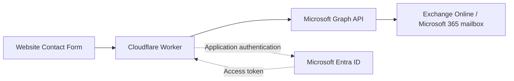

# M365-CONTACT-01 — future contact backend migration

**Status: documented future task; not started.** Direction confirmed by the project owner on 27 October 2026: Formspree is temporary for the competition preview. The eventual replacement uses a Cloudflare Worker, Microsoft Graph and an approved Exchange Online / Microsoft 365 mailbox. This document is a planning record, not authorization to register an application, grant permissions, create mailboxes, configure credentials, provision resources or deploy.

Owners by role: Agent03 coordinates security and data handling; Workflow implements a separately approved change; the Microsoft 365 / Entra tenant administrator approves identities, permissions and mailbox scope; the inquiry owner approves destination, handling and retention. Named owners and timing remain to be recorded privately. No new chat, automation or implementation run was started.

## Planned architecture

Entra ID supplies [application authentication/authorization](https://learn.microsoft.com/en-us/entra/identity-platform/v2-oauth2-client-creds-grant-flow); it is **not email hosting**. Tokens and credentials remain server-side. The browser submits to a same-origin Worker endpoint, never directly to Graph with a credential or app token. The current fixed Formspree endpoint remains active until a separately approved cutover.

## Identity, mailbox scope and secrets

- Plan app-only authentication with the tenant administrator. Select a suitable supported application credential mechanism and lifecycle; do not assume a Cloudflare-to-Entra federation arrangement already exists. If a client secret or private credential is needed, use Cloudflare server-side secrets with scoped deployment access, rotation/expiry ownership and separate environments. Never put it in PUBLIC variables, repository files, browser bundles, diagnostic logs or reports. No values are requested or configured now.
- Plan the least privileged Graph mail-sending capability for the **approved sending mailbox only**. Evaluate current Exchange Online RBAC for Applications and its scoped `Application Mail.Send` role with the tenant administrator. Do not grant mailbox read/full access merely to send a contact inquiry.
- RBAC scope is not a cure for a parallel tenant-wide grant: [Microsoft documents](https://learn.microsoft.com/en-us/exchange/permissions-exo/application-rbac) that Entra consented permissions and Exchange RBAC permissions are additive. The final design must eliminate any equivalent unscoped grant that defeats the intended mailbox restriction and prove an allowed-mailbox positive plus an out-of-scope-mailbox denial. Administrator test results alone must not be confused with live API authorization after permission-cache propagation.
- Use the approved mailbox identity in the application-only `/users/{approved-sender}/sendMail` path; `/me` is not the app-only sender choice. The approved recipient list is a separate Worker-side invariant: constraining the sending mailbox does not constrain a caller-selected To address. Use fixed sender/recipients and controlled subject; a validated visitor address may be Reply-To. Do not accept caller-supplied From/To/CC/BCC or arbitrary forwarding/webhook destinations.

## Reusable controls and current implementation boundary

| Control | Present source evidence | Future work / acceptance criterion |
|---|---|---|
| Server-side validation and limits | Retained disabled `worker/index.ts` preparation has method/type/schema, streamed body/time and field limits; shared inquiry field definitions exist. | Reuse only after review against the selected Graph contract. Enforce before Graph calls, reject files/unknown/duplicate/envelope fields, preserve legitimate Unicode/newlines, prevent header injection and bound serialized work. Client checks are usability only. |
| Rate/bot/outbound protection | Dormant guard/Turnstile code exists; it is not active for current Formspree forms. | Revalidate per-client/global/outbound limits, trusted edge identity, token hostname/action/freshness/reuse and fail-closed outages. Resolve the previously noted quota-accounting/cancellation design before activation. Do not assume distributed enforcement from process-local counters. |
| Headers/CSP/cache | Public static/shared Worker policy and safe error/asset-cache controls exist; strict-origin-when-cross-origin proposal remains appropriate for public pages. | Apply no-store and safe response headers to the new API; verify rendered pages and all failure paths. Graph is a server-side call, so it does not justify adding Graph/token endpoints to browser CSP. Remove obsolete Formspree allowances only with the approved cutover and tests. |
| Errors and delivery | Current UI distinguishes provider acceptance from inbox receipt; dormant reservations illustrate uncertainty handling. | Graph sendMail returns202 without a response body; acceptance does not prove completed processing or delivery. Use bounded deadlines/retries and throttling handling, reconcile ambiguous sends, and prevent avoidable duplicates. Do not promise exactly-once delivery or silently replay a timed-out send. Add a queue only if justified. |
| Personal data and logging | Current contact controller does not persist inquiry fields in browser storage; diagnostic policy excludes bodies/secrets. | Log only minimal outcome/time/request reference with protected access/retention, not bodies, full addresses, tokens or raw provider errors. Keep personal data out of URLs/shared caches. |
| Retention and operations | Preview Formspree/archive/temporary-inbox copies are documented, not automatically erased by rollback. | Approve responsible inquiry/privacy owners, mailbox access, Sent Items behavior, delivery/quarantine/bounce handling, retention/holds and deletion across copies. Graph normally saves a sent copy; a saveToSentItems choice does not override Exchange retention or other copies. Update privacy and incident/credential-rotation procedures before activation. |
| Release/security | Existing targets and recovery identities are separate. | Review CI/deployment secret access, protect production authority, isolate test data/credentials, and verify exact target/artifact/rollback. Do not reuse RC global-noindex/hostname configuration as production configuration. |

This retained preparation is not an implemented Graph backend. Its validation, Turnstile, guard and native-email declarations do not protect current direct Formspree submissions, and its email binding is not the selected Microsoft 365 integration.

## Separate implementation task exit criteria

1. Approve the sender/recipient mailboxes, owners, privacy/retention decisions, app identity/credential design and effective mailbox authorization scope. Keep actual identifiers and settings evidence private as appropriate.
2. Implement the Worker-to-Graph adapter and required controls in a separately authorized change. First validate with synthetic local/mock data in an appropriate sandbox, including invalid/oversized input, abuse controls, credential outage, unauthorized mailbox, throttling, timeout/uncertain delivery, duplicate prevention and safe logs.
3. Separately authorize controlled end-to-end testing to the approved test mailbox, prove API acceptance and actual receipt independently, and review precise release/recovery steps. No DNS or broad authentication changes are implied.
4. Only after target-specific approval, cut over endpoint/CSP/secret/runtime configuration and approved privacy wording. Verify JavaScript and native/no-JavaScript behavior and fallback contacts. Retire Formspree collection with its owner and handle remaining archives/mail copies under the approved policy; frontend removal alone is insufficient.

Migration timing is an owner decision, not a new requirement to build it during this validation. No complicated temporary Formspree integration or testing platform is proposed. Keep the existing policy/documentation improvements and defer Graph adapters, Entra configuration and account operations to M365-CONTACT-01.

Primary references checked 27 October 2026: [Entra application authentication](https://learn.microsoft.com/en-us/entra/identity-platform/v2-oauth2-client-creds-grant-flow), [Exchange application RBAC and additive permission grants](https://learn.microsoft.com/en-us/exchange/permissions-exo/application-rbac), [Graph sendMail permission/acceptance/Sent Items behavior](https://learn.microsoft.com/en-us/graph/api/user-sendmail?view=graph-rest-1.0), [Cloudflare secrets](https://developers.cloudflare.com/workers/configuration/secrets/). Recheck current tenant/provider requirements when implementation is authorized.
